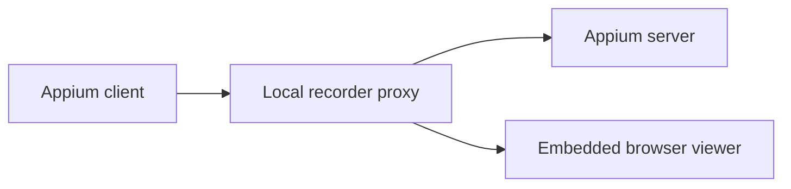

# Appium Session Recorder — Rust

A local Appium proxy and JSON-first automation CLI. It records actions, screenshots, and page source; ranks selectors; and streams captured sessions to an embedded browser viewer. The proxy, CLI, XML/HTML parser, and selector engine run in Rust; the viewer uses plain HTML, CSS, and JavaScript bundled into the binary.

## Features

- Records Appium actions and associates element actions with the selector that resolved them.
- Captures screenshots and HTML/XML page source after successful actions.
- Streams updates to a browser viewer with Server-Sent Events.
- Inspects XML, tests selectors, compares screens, summarizes journeys, and checks selector stability.
- Provides scriptable `session`, `screen`, `selectors`, and `drive` commands.
- Supports iOS, Android, and generic Appium XML.

## Requirements

- Rust 1.85 or newer to build (verified with Rust 1.85.1 and 1.99.1)
- A running [Appium](https://appium.io/) server for device commands

## Install

```bash
cargo install --path . --locked
```

Or build the standalone binary:

```bash
cargo build --release --locked
./target/release/appium-recorder --help
```

No Bun, Node.js, or frontend build is required. The binary embeds the viewer assets.

## Start recording

```bash
appium --port 4723
appium-recorder
```

Or supply the proxy configuration:

```bash
appium-recorder \
  --port 4724 \
  --host 127.0.0.1 \
  --appium-url http://127.0.0.1:4723
```

Point Appium Inspector or another client at `http://127.0.0.1:4724`, then open `http://127.0.0.1:4724/_recorder`.

The recorder only accepts `localhost`, `127.0.0.1`, or `::1` as its bind host.

## Command mode

Command mode writes one JSON response to stdout. Add `--pretty` for formatted JSON or `--output <path>` to write it to a file instead of stdout.

```text
appium-recorder <group> <command> [flags]
```

Available commands:

- `proxy start`
- `session create`, `session delete`
- `screen snapshot`, `screen elements`
- `selectors best`
- `drive tap`, `drive type`, `drive back`, `drive swipe`, `drive scroll`

Create a session:

```bash
appium-recorder session create \
  --appium-url http://127.0.0.1:4723 \
  --caps-file ./caps.json \
  --pretty
```

List actionable elements and rank selectors:

```bash
appium-recorder screen elements \
  --appium-url http://127.0.0.1:4723 \
  --session-id "$SESSION_ID" \
  --only-actionable \
  --limit 80

appium-recorder selectors best \
  --appium-url http://127.0.0.1:4723 \
  --session-id "$SESSION_ID" \
  --element-ref "<ELEMENT_REF>"
```

Drive the session:

```bash
appium-recorder drive tap \
  --appium-url http://127.0.0.1:4723 \
  --session-id "$SESSION_ID" \
  --using "accessibility id" \
  --value "Continue"

appium-recorder drive type \
  --appium-url http://127.0.0.1:4723 \
  --session-id "$SESSION_ID" \
  --using id \
  --value "com.example:id/email" \
  --text "user@example.com" \
  --clear-first

appium-recorder drive scroll \
  --appium-url http://127.0.0.1:4723 \
  --session-id "$SESSION_ID" \
  --direction down
```

Delete the session:

```bash
appium-recorder session delete \
  --appium-url http://127.0.0.1:4723 \
  --session-id "$SESSION_ID"
```

The repository includes the [appium-cli-selector-navigator skill](skills/appium-cli-selector-navigator).

## Configuration

| Option | Default | Constraint |
|---|---:|---|
| `--port`, `-p` | `4724` | Integer from 1 to 65535 |
| `--host` | `127.0.0.1` | Loopback only |
| `--appium-url`, `-u` | `http://127.0.0.1:4723` | HTTP(S), without credentials, query, or fragment |
| `--help`, `-h` | | Show help |
| `--version`, `-v` | | Show version |

Environment variables:

```bash
APPIUM_URL=http://127.0.0.1:4723
PROXY_PORT=4724
PROXY_HOST=127.0.0.1
appium-recorder
```

Explicit CLI values take precedence over interactive values, environment variables, and defaults.

## Security

The recorder is an unauthenticated local development tool. It rejects non-loopback bind configuration and HTTP requests with foreign `Host` or `Origin` values. Do not port-forward or otherwise expose it to an untrusted network.

The server limits request bodies, upstream response buffering, selector mappings, parsed XML, and retained history. Session and element IDs are URL-encoded before direct Appium commands. Page source is rendered as text, never injected as HTML.

The configured Appium server may be remote, but its URL must use HTTP(S) and must not contain credentials. Protect the Appium endpoint separately.

## Development

```bash
cargo run -- --port 4724 --appium-url http://127.0.0.1:4723
```

Open `http://127.0.0.1:4724/_recorder` to view captured actions. Without flags,
interactive terminals prompt for connection settings; noninteractive invocations
use environment variables and defaults. `proxy start` always uses its explicit
flags and defaults and writes a JSON startup response after binding succeeds.

Verification:

```bash
cargo fmt --all -- --check
cargo clippy --all-targets --locked -- -D warnings
cargo test --locked
cargo build --release --locked
```

On Unix, `python3 tests/legacy_prompt.py` checks terminal validation and Ctrl+C.

Tests use local mock Appium servers and do not require a device. Real-device
behavior still depends on the installed Appium drivers and device capabilities.

The Rust port is based on upstream commit
`1dc887960982727d977d95f9943cc3f3b0d478ec`. The command names, response envelopes,
recorder API, history limits, and selector strategies are preserved. The viewer
is rebuilt with native browser APIs. XML inspection, selector testing and
stability analysis run through `POST /_recorder/api/inspect`; the other recorder
API paths remain the same.

Selector score ties use deterministic Unicode ordering, which can differ from
the original JavaScript runtime's locale ordering.

The browser smoke test exercises the running Rust proxy with Chromium and runs
in CI. With Playwright and its Chromium browser already installed, run:

```bash
cargo build --locked
PLAYWRIGHT_MODULE=/path/to/playwright node tests/viewer_smoke.cjs
```

Set `CHROMIUM_BINARY` or `RECORDER_BINARY` to override the browser or recorder
binary paths used by this test. Without `CHROMIUM_BINARY`, the test uses
Playwright's bundled Chromium.

## Recorded data

Each recorded action can include its method, path, action metadata, associated selector, timestamp, page source, and a screenshot URL backed by bounded in-memory storage. Request bodies and session IDs are not retained.

History retains at most 500 interactions and 100 MiB of captured data, evicting the oldest entries first.

## Architecture


