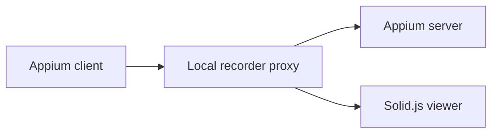

# Appium Session Recorder

A local Appium proxy and JSON-first automation CLI. It records actions, screenshots, and page source; ranks selectors; and streams captured sessions to a Solid.js viewer.

## Features

- Records Appium actions and associates element actions with the selector that resolved them.
- Captures screenshots and HTML/XML page source after successful actions.
- Streams updates to a browser viewer with Server-Sent Events.
- Inspects XML, tests selectors, compares screens, summarizes journeys, and checks selector stability.
- Provides scriptable `session`, `screen`, `selectors`, and `drive` commands.
- Supports iOS, Android, and generic Appium XML.

## Requirements

- [Bun](https://bun.sh/) 1.4 or newer
- A running [Appium](https://appium.io/) server

## Install

```bash
bun add --global appium-session-recorder
```

The package can also be installed with npm when Bun is already available on `PATH`:

```bash
npm install --global appium-session-recorder
```

## Start recording

```bash
appium --port 4723
appium-recorder
```

Or supply the proxy configuration:

```bash
appium-recorder \
  --port 4724 \
  --host 127.0.0.1 \
  --appium-url http://127.0.0.1:4723
```

Point Appium Inspector or another client at `http://127.0.0.1:4724`, then open `http://127.0.0.1:4724/_recorder`.

The recorder only accepts `localhost`, `127.0.0.1`, or `::1` as its bind host.

## Command mode

Command mode writes one JSON response to stdout. Add `--pretty` for formatted JSON or `--output <path>` to write it to a file instead of stdout.

```text
appium-recorder <group> <command> [flags]
```

Available commands:

- `proxy start`
- `session create`, `session delete`
- `screen snapshot`, `screen elements`
- `selectors best`
- `drive tap`, `drive type`, `drive back`, `drive swipe`, `drive scroll`

Create a session:

```bash
appium-recorder session create \
  --appium-url http://127.0.0.1:4723 \
  --caps-file ./caps.json \
  --pretty
```

List actionable elements and rank selectors:

```bash
appium-recorder screen elements \
  --appium-url http://127.0.0.1:4723 \
  --session-id "$SESSION_ID" \
  --only-actionable \
  --limit 80

appium-recorder selectors best \
  --appium-url http://127.0.0.1:4723 \
  --session-id "$SESSION_ID" \
  --element-ref "<ELEMENT_REF>"
```

Drive the session:

```bash
appium-recorder drive tap \
  --appium-url http://127.0.0.1:4723 \
  --session-id "$SESSION_ID" \
  --using "accessibility id" \
  --value "Continue"

appium-recorder drive type \
  --appium-url http://127.0.0.1:4723 \
  --session-id "$SESSION_ID" \
  --using id \
  --value "com.example:id/email" \
  --text "user@example.com" \
  --clear-first

appium-recorder drive scroll \
  --appium-url http://127.0.0.1:4723 \
  --session-id "$SESSION_ID" \
  --direction down
```

Delete the session:

```bash
appium-recorder session delete \
  --appium-url http://127.0.0.1:4723 \
  --session-id "$SESSION_ID"
```

The repository includes the [appium-cli-selector-navigator skill](skills/appium-cli-selector-navigator).

## Configuration

| Option | Default | Constraint |
|---|---:|---|
| `--port`, `-p` | `4724` | Integer from 1 to 65535 |
| `--host` | `127.0.0.1` | Loopback only |
| `--appium-url`, `-u` | `http://127.0.0.1:4723` | HTTP(S), without credentials, query, or fragment |
| `--help`, `-h` | | Show help |
| `--version`, `-v` | | Show version |

Environment variables:

```bash
APPIUM_URL=http://127.0.0.1:4723
PROXY_PORT=4724
PROXY_HOST=127.0.0.1
appium-recorder
```

Explicit CLI values take precedence over interactive values, environment variables, and defaults.

## Security

The recorder is an unauthenticated local development tool. It rejects non-loopback bind configuration and HTTP requests with foreign `Host` or `Origin` values. Do not port-forward or otherwise expose it to an untrusted network.

The server limits request bodies, upstream response buffering, selector mappings, parsed XML, and retained history. Session and element IDs are URL-encoded before direct Appium commands. Page source is rendered as text, never injected as HTML.

The configured Appium server may be remote, but its URL must use HTTP(S) and must not contain credentials. Protect the Appium endpoint separately.

## Development

```bash
git clone https://github.com/JustasMonkev/appium-session-recorder.git
cd appium-session-recorder
bun install

# Terminal 1: recorder API/proxy
bun run dev -- --port 4724 --appium-url http://127.0.0.1:4723

# Terminal 2: viewer with API proxying
bun run dev:ui
```

Open `http://127.0.0.1:3000/_recorder/` while both processes run.

Verification:

```bash
bun run lint
bun run typecheck
bun run test
bun run test:coverage
bun run build
```

The build bundles the CLI for Bun and writes the viewer to `dist/ui`.

## Recorded data

Each recorded action can include its method, path, action metadata, associated selector, timestamp, page source, and a screenshot URL backed by bounded in-memory storage. Request bodies and session IDs are not retained.

History retains at most 500 interactions and 100 MiB of captured data, evicting the oldest entries first.

## Architecture


